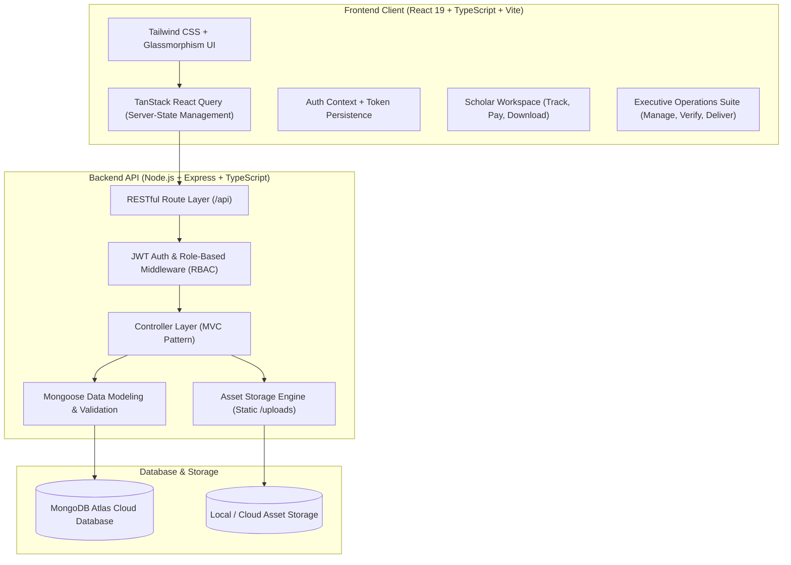
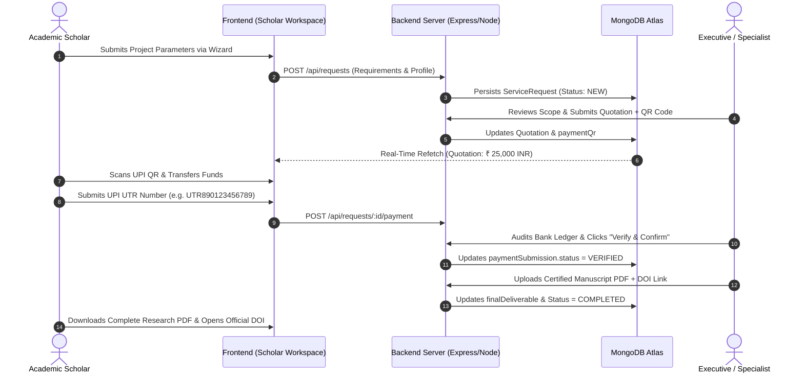

<div align="center">

# 🎓 Research Hub
### Enterprise Academic Advisory, Manuscript Development & Publication Platform

[](https://www.typescriptlang.org/)
[](https://react.dev/)
[](https://nodejs.org/)
[](https://expressjs.com/)
[](https://www.mongodb.com/)
[](https://vitejs.dev/)
[](https://tailwindcss.com/)
[](https://opensource.org/licenses/MIT)

<p align="center">
  <strong>A mission-critical, full-lifecycle academic advisory platform designed for postgraduate scholars, research scholars, and academic institutions worldwide. Engineered with end-to-end TypeScript, role-based architecture, real-time UPI payment reconciliation, and certified digital deliverable distribution.</strong>
</p>

[Explore Live Demo](#-quick-start--local-setup) • [Architecture Overview](#-system-architecture) • [Key Features](#-core-capabilities--modules) • [API Documentation](#-api-endpoints-summary) • [Contact Developer](#-author--connect)

---

</div>

## 📌 Executive Summary

**Research Hub** addresses the complex operational bottlenecks in academic advisory, peer-review formatting, and high-impact journal publishing (IEEE, Scopus, Springer, Nature, UGC-CARE). Built with production-ready standards, it bridges the gap between academic researchers and specialized advisory teams by providing:

1. **Interactive Multi-Step Research Wizard** for granular project scoping and discipline selection.
2. **Executive Specialist Management Suite** for workload distribution, quotation budgeting, and audit logging.
3. **Automated Quotation & UPI QR Payment Pipeline** with Indian Rupee (INR) and multi-currency support, UTR reference tracking, and administrator-side verification.
4. **Certified Manuscript Deliverables Vault** enabling completed research paper PDF distribution and official publication **DOI (Digital Object Identifier)** linking.
5. **Defensive UX Security Controls** including a double-confirmation security verification code modal preventing accidental request cancellations.

---

## 🏗️ System Architecture

The application adopts a **Decoupled Client-Server Monorepo** architecture ensuring clear separation of concerns, strict type-safety, and horizontal scalability.



---

## 🚀 Core Capabilities & Modules

### 1. 🎓 Scholar Workspace (Client-Facing)
- **Interactive Multi-Step Scoping Wizard:** Guides scholars through academic level selection (Ph.D., Postdoc, Faculty), target journal formatting (IEEE, Elsevier, Springer), citation styles, word count specifications, and reference manuscript uploads.
- **Real-Time Request Lifecycle Tracking:** Instant visibility across request phases: `NEW` ➔ `UNDER_REVIEW` ➔ `QUOTATION_SENT` ➔ `IN_PROGRESS` ➔ `COMPLETED`.
- **UPI QR Code & Bank Settlement:** Generates dynamic QR presentation with copyable UPI VPA, enabling one-click payment via Google Pay, PhonePe, Paytm, or BHIM.
- **Payment Verification Submission:** Pre-fills request reference numbers (`RH-XXXXXX-XXXX`), collects 12-digit UPI UTR numbers, payer identity, transfer notes, and payment proof receipts.
- **Deliverables & Manuscript Vault:** Direct one-click download for finalized publication PDFs and live deep-links to certified DOI articles.
- **Accidental Cancellation Security Guard:** Prevents misclicks through an interactive **Security Verification Code modal**, requiring scholars to type a dynamic 4-digit code to confirm cancellation.

### 2. ⚡ Executive Operations Suite (Admin-Facing)
- **High-Altitude Analytics Dashboard:** Real-time metrics tracking active submissions, pending specialist reviews, verified revenues, and turnaround SLAs.
- **Granular Request Management:** Real-time status transitions, specialist assignment, and customer-facing advisory notes.
- **Dynamic Quotation Engine:** Issues formal project quotations in INR (₹) or foreign currencies (USD, EUR, GBP) that reflect instantly on the scholar's workspace.
- **Audit-Grade Payment Verification:** Inspects submitted UPI UTR numbers, payer details, and receipt screenshots with one-click **"Verify & Confirm Payment"** or **"Reject with Remarks"** workflows.
- **Certified Deliverable Deployment:** Uploads finished manuscripts (PDF) and binds official publication DOI URLs directly to scholar accounts.
- **Platform Communication & WhatsApp Hub:** Real-time configuration of WhatsApp Business routing numbers, default inquiry message templates, support telephone lines, and ethics policies.

---

## 🛠️ Technology Stack & Engineering Decisions

| Layer | Technologies | Engineering Rationale |
| :--- | :--- | :--- |
| **Frontend** | React 19, TypeScript, Vite | Ultra-fast HMR, component reusability, and end-to-end type safety. |
| **Styling & Design** | Tailwind CSS, Lucide React | Curated dark-mode aesthetic with custom glassmorphism and responsive layouts. |
| **State & Caching** | TanStack React Query v5 | Automatic background refetching, cache invalidation, and zero-stale state sync across tabs. |
| **Backend API** | Node.js, Express.js, TypeScript | High-throughput asynchronous I/O with clean controller-service architecture. |
| **Database & ODM** | MongoDB Atlas, Mongoose 8 | Flexible document modeling for dynamic research requirements and robust schema validation. |
| **Authentication** | JWT (JSON Web Tokens), bcryptjs | Stateless, tamper-proof session tokens with salted password hashing and role enforcement. |
| **Asset Storage** | Base64 Multi-Folder Storage Engine | Fast inline upload of QR codes, payment receipts, and research manuscript PDFs. |
| **DevOps & Tooling** | tsx, ESLint, Git, Dotenvx | Production build validation, strict typecheck passes, and automated seed scripts. |

---

## 📊 End-to-End Workflow Pipeline



---

## 🔌 API Endpoints Summary

### 🔐 Authentication & Accounts
| Method | Endpoint | Access | Description |
| :--- | :--- | :--- | :--- |
| `POST` | `/api/auth/register` | Public | Registers new academic scholar account |
| `POST` | `/api/auth/login` | Public | Authenticates credentials and returns JWT token |
| `GET` | `/api/auth/me` | Authenticated | Fetches current user profile and role details |
| `PUT` | `/api/auth/profile` | Authenticated | Updates contact details and academic affiliations |

### 📝 Customer Research Requests
| Method | Endpoint | Access | Description |
| :--- | :--- | :--- | :--- |
| `GET` | `/api/requests/my` | Scholar | Lists authenticated user's submitted requests |
| `POST` | `/api/requests` | Scholar | Submits new research project parameters |
| `POST` | `/api/requests/:id/payment` | Scholar | Submits UPI UTR number and receipt for verification |
| `PATCH` | `/api/requests/:id/cancel` | Scholar | Cancels request with verification check |

### 🛠️ Executive Admin Operations
| Method | Endpoint | Access | Description |
| :--- | :--- | :--- | :--- |
| `GET` | `/api/admin/overview` | Admin / Specialist | Real-time performance metrics and request counts |
| `GET` | `/api/admin/requests` | Admin / Specialist | Paginated, searchable request management list |
| `PUT` | `/api/admin/requests/:id` | Admin / Specialist | Updates status, quotation, QR, deliverables & verifies payment |
| `GET` | `/api/admin/settings` | Admin | Fetches global platform, WhatsApp, and contact configurations |
| `PUT` | `/api/admin/settings` | Admin | Updates WhatsApp business number and support phone lines |
| `POST` | `/api/upload` | Authenticated | Processes and stores base64 assets (QRs, PDFs, receipts) |

---

## 💻 Quick Start & Local Setup

### Prerequisites
- **Node.js** (v18.0.0 or higher)
- **npm** (v9.0.0 or higher)
- **MongoDB Atlas** account or local MongoDB instance

### 1. Clone the Repository
```bash
git clone https://github.com/Shahbazk03/Research-HUB.git
cd Research-HUB
```

### 2. Backend Setup
```bash
cd server
npm install

# Create environment configuration
cp .env.example .env
```

Configure your `.env` file:
```env
PORT=5000
NODE_ENV=development
DATABASE_URL="your_mongodb_connection_string"
JWT_SECRET="your_strong_jwt_secret"
ADMIN_EMAIL="admin@researchhub.com"
ADMIN_PASSWORD="AdminPassword123!"
```

Seed initial services, categories, and administrator credentials:
```bash
npm run seed
```

Start the backend development server:
```bash
npm run dev
```
Backend runs on: `http://localhost:5000`  
API Health Check: `http://localhost:5000/api/health`

### 3. Frontend Client Setup
```bash
cd ../Client
npm install
npm run dev
```
Frontend runs on: `http://localhost:5173`

---

## 🧪 Production Verification & Quality Assurance

Both frontend and backend codebases have undergone strict automated validation:
- **TypeScript Strict Mode:** Passed with **0 errors** across both `Client` and `server`.
- **Production Bundling:** Built via Vite production pipeline in **under 5 seconds**.
- **Cross-Browser Verification:** Validated via automated browser subagents across end-to-end user workflows:
  - Quotation issuance in INR (₹) and persistence.
  - UPI QR code presentation and UTR submission.
  - Administrative payment verification and status badge sync.
  - Final manuscript PDF distribution and official DOI link verification.
  - Accidental cancellation modal with 4-digit code matching validation.
  - Live synchronization of WhatsApp and Support telephone numbers across all pages.

---

## 👨‍💻 Author & Connect

**Mohd Shahbaz**  
*Full Stack Software Engineer | React, Node.js & Scalable Web Architecture*

- **GitHub:** [@Shahbazk03](https://github.com/Shahbazk03)
- **Repository:** [Research-HUB](https://github.com/Shahbazk03/Research-HUB)
- **Email:** mohdshahbazk03@gmail.com
- **LinkedIn:** [Mohd Shahbaz](https://www.linkedin.com/in/mohdshahbazk03)

---

<div align="center">
  <sub>Engineered with precision for modern academic research advisory and enterprise software engineering excellence.</sub>
</div>
